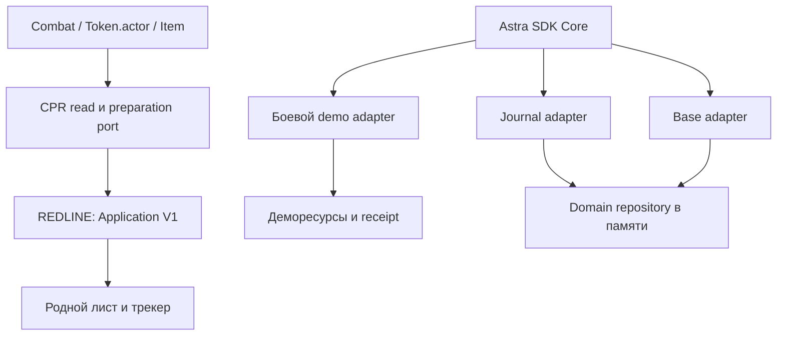
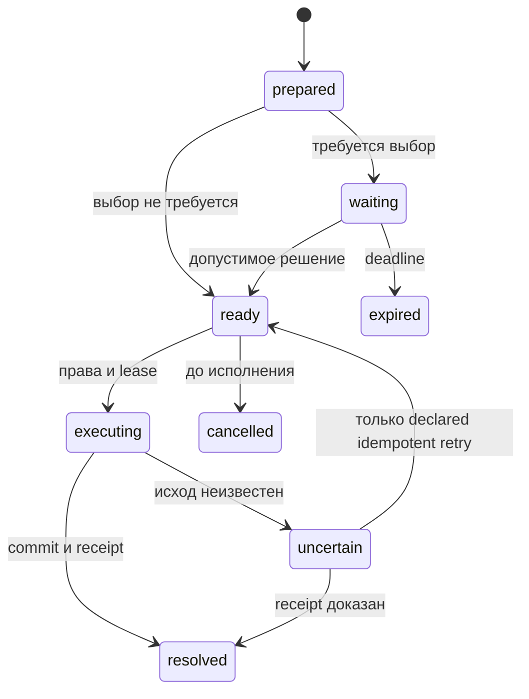

# Разработка Astra / REDLINE · Alpha 0.2

08.10.2026. Версия пакетов: `0.2.0-alpha.1`. Следующий программный срез после read-only alpha 0.1. Рабочий мир и исходные репозитории не изменены.

## Конкретный результат

Общее ядро теперь исполняет реальные локальные операции трёх разных адаптеров. Боевой стенд проходит подготовку, выбор защиты, отдельное исполнение, результат с квитанцией и восстановление. Журнал раскрывает выбранную ветку; база резервирует ресурс и фиксирует ресурс/прогресс вместе с квитанцией. Это проверяемая переиспользуемость общего кода, а не три независимых макета.

Нативный модуль Foundry расширен подготовкой обычного одиночного выстрела. Читает доступные документы, показывает источник DV и причины блокировки, принимает только ограниченные параметры предпросмотра. **Системное исполнение остаётся выключенным.** Локальный демостенд не подключён к миру.

| Уровень | Выполнено | Чего это не подтверждает |
|---|---|---|
| Изучено по источникам | Foundry v12; первичные правила RTG; Easy Mode; официальный source tag CPR v0.89.2; прежние исследования модулей сохранены отдельно | Installed build, published ZIP CPR или совпадение source tag с сервером |
| Визуально воспроизведено | Новые отдельные native/demo HTML/CSS, демонстрационные сцена/данные | Live Foundry screenshot или визуальная QA новой версии |
| Прототипировано | SDK operation kernel, три адаптера, native preparation, полный локальный бой и SDK lab | Готовый production SDK, полный бой по всем правилам |
| Проверено локально | 125/125 Node tests; syntax/manifest guard для 27 runtime modules; bundling, ZIP integrity и source-copy hashes | Браузерный IndexedDB, реальные два пользователя, remote security |
| Проверено внутри Foundry | Ничего в этой версии | Нельзя объявлять совместимость verified |
| Ещё не реализовано | Native roll/ammo/damage/defense transport, GM authority, native NET, V2 port, полноценная UI library/Studio | Эти функции не включены в установочный bootstrap |

Браузерная визуальная проверка локального preview была отклонена политикой доступной среды. Ограничение не обходилось. Самодостаточные HTML можно открыть обычным браузером пользователя; новой версии не приписываются проверенные размеры/скриншоты/работающие анимации.

## Минимальная архитектура

Стрелки kernel обозначают общий исполняемый код, а не сетевой канал. Native port пока не запускает kernel для мутации документов: безопасный bridge к штатной операции должен быть проверен отдельно.

| Упаковка | Состав сейчас | Зависимости и дальнейшая граница |
|---|---|---|
| `astra-sdk-core` | 7 нейтральных SDK modules + Scope/RefreshScheduler, library manifest, экспорт API | Optional; нет CPR/Studio/transport. Будущий адаптер задаёт trusted principal и операции |
| `astra-redline-combat` | Native read/preparation port, original UI V1; отдельные tools/demo/examples | Самодостаточная alpha, содержит ядро для стенда. Обязательная requires пока не заявлена |
| Будущий UI пакет | Общие panels/focus/preferences/theme/animation primitives | Не объявлен готовым: нынешний боевой renderer ещё специализирован |
| Будущий CPR executor | Native action mapping, validated rolls/resource semantics, permissions | Только после baseline установленной версии; не внутри effects/UI |
| Будущие effects/Studio | DOM/canvas отдельно, редакторы отдельно от runtime | В этот срез не включены |

Optional library действительно собирается из тех же байтов SDK и хранит SHA256. `library:true` проверено по [Module v12](https://foundryvtt.com/api/v12/classes/client.Module.html). `relationships.requires` пригодится после выделения проверенного runtime dependency range; преждевременной обязательной зависимости сейчас нет. Архивы локальные, релизы и manifest URLs не публиковались.

## Контракт и состояния

Kernel descriptor содержит id/version, args/result schema, фактический validate, permission, preview, execute, optional decision/reconcile/compensate/cleanup и описание mutates. Каталог сообщает только реализованные операции. Schema описывает контракт; validate выполняет проверку. JSON вход ограничен, accessors/функции/non-finite значения отвергаются.

Это существенные переходы, не исчерпывающая схема: полный `TRANSITIONS` находится в `scripts/sdk/machine.mjs`. Compensation разрешена только явно поддерживающим её адаптером; для боевого демо она отсутствует. Ошибки rights/missing-data/invalid-input/conflict/no-executor/uncertain/expired не превращаются друг в друга.

Request identity связывает request ID, operation, canonical arguments и requester. Повтор тех же аргументов возвращает прежнюю запись; другая команда с тем же ID — conflict. Executor записывает начало до вызова адаптера, использует lease/fence и повторяет permissions. Потеря подтверждения переводится в uncertain. Сверка receipt не должна слепо усыновлять запись по одному ID.

В боевом демо доменные ресурсы и receipt находятся в одной IndexedDB transaction. Process record находится отдельно: существует зазор между commit и записью resolved. Reconcile восстанавливает подтверждённый результат без повторного списания. Это не обещание распределённого exactly-once для Foundry.

Deadline сохранён; закрытые клиенты не выполняют постоянный процесс. Следующий запуск проверяет срок. Один профиль/origin не равен двум Foundry-клиентам разных пользователей. Авторитетный shared store/transport и GM election ещё отсутствуют.

## UI и сценарии

Тёмные непрозрачные панели, сдержанные углы и раздельные selected/current/target. Верхняя очередь, нижний персонаж, подробности в контекстной панели. Красный/жёлтый/голубой дополняются текстом и значками. Портреты в новом стенде обозначены буквенными placeholders; качественные media assets и NET design остаются в прежнем исследовательском комплекте, не подменяют интеграцию.

Один HTML показывает самостоятельные крупные состояния preparation, defense, result/damage, GM и recovery. Настройки compact/collapse/100–130%/reduced motion реализованы. Предусмотрены fixtures empty/no weapon/empty magazine/unknown DV/hidden target/long labels/40 participants. Доступна отдельная lab панель журнала и базы. Не утверждаем, что эти состояния уже прошли браузерную проверку 1920×1080 и 1366×768.

Attack total **не существует до решения защиты**: детерминированные sample числа создаются только в execute. Это демонстрационная реализация, не системный Roll. Смена персонажа/оружия после prepare не перенаправляет списание: immutable command содержит original identities и отдельный ammoKey. Domain schema v2 имеет отдельные магазины шести demo profiles; ограниченная миграция старого scalar magazine относится только к первоначальному Proxy/AR. Неизвестная/повреждённая схема блокирует сценарий, а не silently reset.

Демо GM может видеть private authority record. Сам переключатель роли не является реальной аутентификацией; исходники стенда содержат демонстрационные данные. В рабочем проекте неизвестные данные останутся у доверенного исполнителя и не будут переданы игроку с надеждой спрятать CSS.

## Исправления независимой проверки

1. Исполнение могло вернуть failed/uncertain без throw, а UI объявлял MISS. Теперь resolved outcome показывается только при подтверждённом applied receipt; иначе recovery.
2. Receipt lookup по request ID мог принять другую defense decision. Reconcile теперь сверяет namespace, точный command и решение.
3. Пока операция ожидала, UI подписывал её текущим selected actor. Снимок имён/оружия/цели теперь относится к исходному запросу; нижняя selection остаётся независимой.
4. Общий scalar magazine заменён ammoByKey; ожидание при смене оружия расходует первоначальный магазин.
5. Статичная demo initiative заменена реальным демопереходом после подтверждённого результата. Current/next/round меняются; повтор квитанции не продвигает ход второй раз. Selected/target независимы, native Combat не меняется.

Четыре независимых regression tests и остальные сценарии входят в полный результат 125/125. Они проверяют программное поведение, а не изображение или настоящий Foundry.

## Следующий интеграционный срез и приёмка

Сначала read-only baseline: записать world/build/system/module versions, проверить native HUD, permissions, synthetic Actor и lifecycle. Затем одна системная операция: **ordinary single ranged attack**, сначала через штатный dialog/sheet flow, без произвольной записи HP или дублирования system discharge.

| Операция | Что необходимо проверить до включения |
|---|---|
| Выбор оружия/цели | OWNER, current scene visibility, real equipped item type, effective magazine capacity/upgrades |
| Дистанция/DV | v12 measurePath, units, token endpoints, diagonals/gridless/hex, fractional boundaries; conditional opposed DV |
| Attack modifiers | Native REF/skill, quality, roles, wound/armor/effects, LUCK audit; ручная сумма не сертификация |
| Defense | Правила awareness/REF/exceptions; declaration и Evasion до attack; авторизованный пользователь, hidden payload |
| Roll и расход | Точная installed signature и привычный dialog; system выполняет бросок/расход один раз; cancel ничего не расходует |
| Result и damage | Native chat/result identity; armor ablation, penetrating damage, criticals, ammo effects, permissions; не прямой HP patch |
| Повтор/сбой | Double click, два ответственных клиента, lease loss, commit→ack gap, reconnect; uncertain не даёт слепого retry |
| Ход/NET | Отдельный следующий slice: physical/NET economy, ROF usage; без D&D bonus/reaction pools |

Первичный source tag CPR `v0.89.2` изучен, но `_createAttackRoll` — внутренний метод, не стабильный публичный контракт. В нативном alpha он не вызывается. Подробные правила/URL/ограничения находятся в `CPR-PREPARATION.md`.

Новая live-проверка должна явно фиксировать 1920×1080 и 1366×768, масштаб, русский/длинные подписи, пустое состояние, 40 участников, смену выбранного токена и цели, нет оружия/патронов, hidden targets, повторное нажатие/открытие, reconnect, GM/player, reduced motion и отсутствие утечек listeners/timers. До неё соответствующие строки acceptance остаются непроверенными.

## Сервер и рабочий мир

Наблюдалась ошибка TLS на браузерном пути к предоставленному HTTP join URL до входа. Это не свидетельство того, что сервер выключен. В world не входили, резервная копия/LAB не создавались, модули/документы/настройки не менялись. Все новые файлы находятся в отдельной локальной копии. Для текущего программного среза доступ к серверу не требовался.
