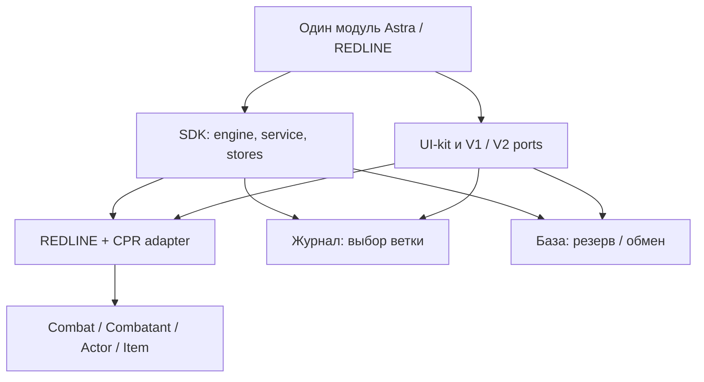

# Astra Foundry / REDLINE · Alpha 0.3

11.10.2026. Подготовка публикационной копии для `horusian161-code/astra-foundry`. Версия `0.3.0-alpha.1`, один устанавливаемый модуль `astra-redline-combat`. Предыдущие alpha сохранены отдельно. Это реальный программный срез для самостоятельной установки и тестирования, **не завершённая боевая автоматизация**. Пользователь выбрал репозиторий и разрешил предварительную публикацию; это не меняет статус live-проверок.

## Изменения текущего этапа

| Реализованный компонент | Конкретный результат |
|---|---|
| Один Foundry package | SDK/core/UI/adapters/HUD входят в один runtime ZIP; отдельный SDK больше не требуется |
| Module API | `game.modules.get('astra-redline-combat').api.sdk` и `.components`; сохранены восемь read/UI/preview операций; client autoOpen позволяет SDK-only использование |
| OperationService | Prepare/decide/execute/get/recover/cancel; каждое обращение заново разрешает trusted principal; request envelope не принимает role/userId/rights/executor; authority state наружу не выдаётся |
| Исправление lifecycle engine | Dispose во время ожидающего permission больше не допускает позднее выполнение; generation guards сохраняют возможность новых вызовов engine |
| Ошибки API | Getter/Proxy `error.code` не исполняется; секретные сообщения адаптера не передаются пользователю |
| UI-kit | Общие панели, заголовки, действия, escaped labels и branded renderedContent; bookmarks фокуса; отмена/reinvoke/AbortSignal/reduced motion/cleanup DOM-анимаций |
| Реальные потребители UI-kit | Native preparation, workflow-панели и SDK-lab журнала/базы; focus/motion в demo и native V1 |
| ApplicationV2 port | Отдельные v12 `_prepareContext`, `_renderHTML`, `_replaceHTML`, public close; нет V1/jQuery эмуляции; cleanup до/после очереди close |
| NativeActionPort | Строгий current token→owned synthetic Actor→embedded weapon; exact runtime profiles; обе source-study версии disabled; отдельный native sheet fallback |
| Release tooling | Детерминированная runtime-сборка, SHA, файл-индекс; alpha prerelease workflow отдельно от strict stable gate; synthetic tests не выдаются за live evidence |

Исследование native API выявило принципиальные ограничения официальных CPR **v0.89.2 и v0.92.4**: exported `rollItemMacro` привязан к chat speaker и имени предмета, не возвращает различимый receipt отмены/успеха; расход/карточка не имеют доказанного завершения; reload меняет несколько документов; damage следует внутреннему `_applyDamage`. Поэтому эти вызовы не объявлены надёжным executor и не включены. Точные первичные URL и pipeline: `NATIVE-ACTION-PORT.md`. Исходник тега не считается опубликованным ZIP или установленной системой мира.

## Фактические проверки

**193/193 Node tests PASS**, `fail=0`, `skipped=0`. Проверены чистые planners, read models/permissions, prepare invalidation, engine/CAS/deadline/idempotency/lease, service identity/privacy, local ledger, turn progression, SDK journal/base adapters, native blocked port, UI mock DOM/WAAPI, V1 lifecycle и V2 mock queued-render/close. Из них release-gate fixtures синтетические и подтверждают только формат/блокировки.

Static check: **35 runtime modules**, `node --check`, существующие manifest paths, v12 alpha metadata без verified, явный mutation/eval pattern guard. Guard не доказывает отсутствие любой возможной мутации. Самодостаточный HTML пересобран pinned **esbuild 0.25.12**, inline JS syntax checked, нет external runtime imports/assets, CSP запрещает сетевые подключения. Для этой сборки использован уже доступный pinned esbuild из отдельного локального проекта. Ранее `npm ci --offline` не смог получить отсутствующий tarball; новая установка dev dependencies и GitHub CI здесь не подтверждены.

Runtime ZIP: **90 193 байта / 42 файла**; SHA256 `6c620c49283e01160099d3ff86d6a09521d429c9a7fecf1eb0af62f35f1864f2`.
Runtime source fingerprint: `e7a060886c92f00052a3a11ad20f80a0d8d2899c8a3d4ffdee4eacef1cd4363d`.
HTML: **209 038 байт**, SHA256 `8edb83d56a12e4b09977affc2d00a0d6931576b8e587ad1057c881de5142a1e7`.

Фактические логи публикационной копии рядом: `validation-publish-tests.txt`,
`validation-publish-source.txt`, `validation-publish-build.json`,
`validation-publish-preview.json`. README включён в runtime fingerprint; изменение
runtime требует пересборки и новых хэшей. Этот отчёт и tooling в runtime ZIP не включены,
поэтому запись его итоговых хэшей не создаёт самоссылочного runtime.

## Структура единого пакета

Боевые правила и ресурсы не живут в анимационном коде. Combat/Combatant и CPR остаются источником истины. REDLINE сейчас читает их; демонстрационный ledger отделён от Foundry. Journal/base используют общий kernel и UI, но только memory fixtures, не реальные JournalEntryPage/сцены. Порт V2 — библиотечный прототип с mock-тестами, тогда как native HUD остаётся V1.

Доверенный модуль может собрать собственные descriptors; `api.sdk.createService({engine})` привязывает публичные вызовы к текущему game.user. Это **клиентская привязка**, не аутентифицированный server transport. Для совместного исполнения ещё нужен отдельный authority/reconciliation adapter. IndexedDB не превращает GM-клиент в сервер и не даёт общей CAS между компьютерами.

## Разделение состояний готовности

| Уровень | Статус этого этапа |
|---|---|
| Изучено по источникам | v12 ApplicationV2/manifest; официальный CPR 0.89.2/0.92.4 native pipeline; предыдущее исследование сторонних HUD сохранено в исторических документах |
| Визуально воспроизведено | HTML/CSS-прототип REDLINE и общие компоненты; новый рендер в браузере **не снимался**. Авторские скриншоты/реконструкции прошлого этапа не являются live-проверкой alpha 0.3 |
| Прототипировано | Связный demo workflow, локальный receipt ledger и очередь, GM/NET views, journal/base примеры; mock lifecycle и trust-boundary tests |
| Проверено внутри Foundry | **Нет**: вход, установка, реальный render и системные операции не выполнены |
| Не реализовано | Сертифицированный native roll/ammo/damage/defense/turn executor, общие persistent receipts/transport/election, настоящий NET workflow, Studio, canvas/media/scene libraries |

Статическая картинка не доказывает анимацию; mock WAAPI доказывает только управление контрактом. Компоновка 1920×1080/1366×768, русские длинные строки, масштаб и доступность требуют реального visual QA. Демостенд содержит соответствующие fixtures, но их наличие не означает прохождение визуальной приёмки.

## Установка и ручной тест

Инструкция в корневом README. Один ZIP распаковывается в `Data/modules/astra-redline-combat`, только в изолированной тестовой копии. После включения: Shift+H→свой токен→оружие→видимая цель→подготовка. Проверяйте отсутствие расхода ресурсов и объяснения неизвестных DV/данных. Настоящие броски/урон выполняйте штатным листом системы, не демонстрационной кнопкой. Закрытие/reopen/scene change проверяйте без изменения боевого мира.

В HTML отдельно воспроизводится подготовка→допустимый демонстрационный выбор защиты→sample result→local apply receipt один раз→demo next turn. Результат создаётся после решения; private payload не надеется на CSS. Это не настоящая CPR-защита и не правило о запасе реакций. Нет D&D-подобных action points/cooldowns.

## Блокеры полной готовности и GitHub

Тестовый HTTP-адрес в доступном облачном браузере на 10.10.2026 был преобразован в HTTPS и вернул **remote server does not speak TLS** до страницы входа. Никаких запросов изменения мира, настроек или модулей не сделано. Рабочий мир не использован для приёмки. Это ограничение данного пути доступа, не диагноз сервера.

По явному выбору пользователя целевой репозиторий — **horusian161-code/astra-foundry**.
В этой изолированной публикационной копии согласованы `module.json`, README и workflow URL.
Планируется предварительный выпуск `v0.3.0-alpha.1` с одним runtime ZIP; отдельного SDK ZIP нет.
Этот отчёт фиксирует локальную подготовку. Целевой пустой public-репозиторий создан
основным агентом через авторизованный браузер. Загрузка исходников, существование release
и доступность публичных assets здесь ещё не подтверждены; они проверяются отдельно после
фактических GitHub-действий. Подготовленные versioned URL не выдаются за уже работающую
публикацию. Исходный каталог `redline-alpha3` не изменён.

Перед публичной загрузкой копия обезличена: личное название рабочего мира удалено
из README, документов и tooling. Stable gate требует свидетельство изолированной
тестовой среды и хэшированный артефакт проверки; личный blacklist не используется.

Для stable необходимы: точная установленная версия системы/Foundry; изолированный мир; GM+player два клиента; live roll/cancel/ammo/reload/damage/defense/turn contracts; корректные receipt и single-application; reconnect/scene/token changes; player/GM projections; visual QA обоих размеров; ручное решение спорных случаев; reviewer acceptance привязанного пакета. Stable gate ожидаемо блокирует текущую alpha. Нет универсального отката или гарантии работы при закрытых клиентах.
