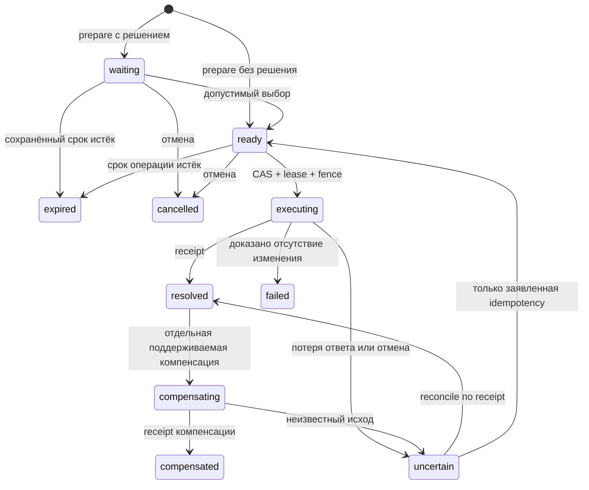

# Astra operation kernel — alpha 0.2

Оригинальное ядро под MIT. Работает без Foundry, Cyberpunk RED, DOM, socketlib и eval. Это исполняемый код в `scripts/sdk/`, а не обещание будущей библиотеки. Foundry alpha использует только свой read-only адаптер; настоящее исполнение системных действий к этому ядру пока не подключено.

## Публичный API

```js
import { OperationEngine, MemoryStore, IndexedDBStore, OperationError }
  from './scripts/sdk/index.mjs';

const descriptor = {
  id: 'example.reserve', version: 1,
  argsSchema: { type: 'object', required: ['amount'] },
  resultSchema: { type: 'object', required: ['reserved'] },
  permissionDescription: 'Authenticated owner only',
  validate: args => Number.isInteger(args.amount) && args.amount > 0,
  permission: (args, { principal, stage, record }) => principal.id === 'owner',
  preview: args => ({ public: { cost: args.amount }, private: {} }),
  // Optional: decision: { options: ['accept', 'decline'], timeoutMs: 30000 }
  execute: async (args, { requestId, fence, signal, assertFence, renewLease }) => {
    await assertFence();
    // Adapter must atomically commit its resources + request receipt.
    // Real shared stores must also validate the fencing token in that commit.
    return { public: { reserved: args.amount }, receipt: { requestId } };
  },
  idempotent: false
};

const engine = new OperationEngine({
  store: new MemoryStore(), descriptors: [descriptor],
  executorId: 'local-demo-authority'
});
const principal = { id: 'owner', role: 'player' };
await engine.prepare({ operation: 'example.reserve', args: { amount: 2 },
  requestId: 'reserve-001', principal });
await engine.execute('reserve-001', { principal });
const safeView = await engine.publicView('reserve-001', { principal });
```

`prepare`, `decide`, `execute`, `recover`, `retry`, `cancel`, `compensate`, `publicView` и `get` возвращают участнику проекцию: `id`, `operation`, `state`, `version`, `preview` (только `preview.public`), `decision`, `result` (только `result.public`), ограниченную квитанцию и код ошибки. Проекция никогда не содержит `args`, `canonicalArgs`, `preview.private`, `result.private`, полный receipt, lease или executor ID. `getAuthorityRecord` дополнительно требует доверенную роль `gm`/`authority` и разрешение `inspect-private`.

`catalog()` сериализует аргументы/результат, описание прав, поддерживаемые валидатор, preview, executor, reconcile и compensate, гарантию idempotent, решение, отмену и очистку. JSON Schema — описание для инструментов; обязательное фактическое исполнение проверки делает `validate`. Наличие schema не подменяет validator.

## Запись и хранилище

Запись имеет `schemaVersion: 1`, `version` для CAS, неизменяемые ID/operation/requester/canonicalArgs, состояние, timestamps, абсолютные сроки, lease `{owner,fence,expiresAt}`, возрастающий `fence`, preview, decision, result и receipt. Неизвестная версия схемы блокируется, вместо автоматической догадки о миграции.

Контракт store:

| Метод | Результат |
|---|---|
| `get(id)` | Отдельная копия record или null |
| `create(record)` | `{created, record}`, создание только при отсутствии ID, начальная version 0 |
| `compareAndSwap(id, expectedVersion, next)` | `{updated, record}`, следующий version ровно `expectedVersion + 1` |
| `list()` | Копии записей; не публичный API для игроков |
| `close()` | Закрывает локальное соединение |

`MemoryStore` атомарен в одном JS runtime. `IndexedDBStore({name})` сохраняет records в браузере и выполняет get/check/put в **одной readwrite transaction**, включая CAS между вкладками одного origin. После обновления страницы создаётся новый engine с тем же именем БД и вызывается `recover`. IndexedDB не синхронизирует независимые браузеры игроков. Серверный store, связь с ответственным GM, выбор полномочного исполнителя и проверка идентичности не реализованы.

Request ID ограничен 1–128 ASCII символами, аргументы — конечными JSON-значениями без accessors/cycles/functions, 64 KiB canonical JSON, глубиной 32 и 8192 значениями. Одинаковые ID+operation+principal+canonical payload возвращают существующую запись. Разница в любом из этих полей вызывает `conflict`. Применяется **точное сравнение**, а не ненадёжный короткий hash.

## Состояния и восстановление



Подготовка и preview не вызывают execute. Решение хранится в записи, таймер UI ничего не решает. Срок в миллисекундах UTC проверяется повторно после reload; истёкший запрос получает `expired`, без выдуманного автоуклонения/попадания. Для распределённого исполнения часы требуют отдельного согласования: здесь доверен `clock` выбранного runtime.

До durable executing marker восстановление сохраняет `ready`: исполнение ещё не началось. После marker отказ консервативно даёт `uncertain`, даже если процесс погиб непосредственно перед вызовом адаптера. Пока lease активен, второй исполнитель не допускается. После истечения lease fence повышается и прежний исполнитель обязан остановиться. Adapter получает `assertFence()` и `renewLease()`. `assertFence()` также повторно проверяет permission в стадии `commit`.

`recover` может сверить квитанцию через `reconcile`; наличие receipt восстанавливает resolved без повторного вызова действия. Без доказательств остаётся uncertain. `retry` отдельно разрешён только для descriptor с `idempotent: true`; ответственность за эту гарантию несёт ledger адаптера. Это не автоматический повтор любого действия.

## Граница надёжности

Ядро не обещает универсального exactly-once. Operation record и игровые ресурсы не находятся в общей транзакции. Самостоятельный `assertFence()` перед внешним commit оставляет границу между проверкой и записью; реальный общий store должен проверять fencing token **внутри атомарной доменной операции**. Доменный адаптер хранит request ID/receipt вместе с изменением ресурса, либо использует уже идемпотентный API. Иначе успешное действие с потерянным ответом остаётся неопределённым.

Запись state `resolved` требует receipt адаптера с совпадающим request ID. Receipt — доказательство в рамках контракта адаптера, не криптографическое подтверждение произвольного сервера. Engine не удостоверяет правдивость недоверенного adapter.

`cancel` до executing безопасно завершает ожидание. Во время executing повышает fence, подаёт AbortSignal локальному адаптеру и оставляет uncertain: часть действия могла уже выполниться. `dispose()` прерывает локальные ожидания; адаптер отвечает за освобождение своих listeners/timers/effects. Ни cancel, ни последний кадр анимации не завершают игровую операцию.

Компенсация — отдельная операция только у descriptor с `compensate`, со своим marker/fence/receipt. Это не универсальный откат. Неопределённая компенсация не сверяется receipt исходного действия и не запускает его повторно; требуется отдельное ручное или будущая доменная процедура разрешения.

## Права и секреты

`principal` приходит от **доверенной интеграции**, а не от пользовательской формы или значения в socket payload. В локальном demo роли переключаются специально; это не authentication. Permission возвращает строго `true`, проверяется на prepare/preview/inspect/decide/execute/recover/reconcile/retry/cancel/compensate и непосредственно перед commit. Join текущего запроса вторым principal не обходит проверку.

Хранилище private записей должно оставаться у доверенного исполнителя. Нельзя сохранять полную запись в flags/socket игрока и надеяться на CSS или projection. IndexedDB в браузере игрока **не может скрыть данные от владельца этого браузера**. Демо хранит условные данные; производственная интеграция должна размещать секреты только на стороне полномочного исполнителя и передавать public projection.

Projection дополнительно удаляет известные ключи `attackTotal`, `attackRoll`, `rawRoll`, `secretDV`, `targetDV`, `hiddenResult` из public preview/result до принятого решения защиты. В private поля всегда остаются закрытыми. Это защита для явного контракта; она не определяет семантику произвольных имён. В descriptor public должны входить только проверенные поля по allowlist. Не вставляйте скрытый бросок в свободный текст preview.public.

## Проверено

`node --test tests/sdk-engine.test.mjs`: 26 тестов состояния, двух исполнителей, повторного клика, payload collision, приватной проекции, прав, сроков после reload, stale fence/renewal, отмены/очистки, восстановления по receipt, запрещённого blind retry и ограниченной компенсации. MemoryStore и API проверены локально. IndexedDB transaction реализована, но её browser runtime проверяет отдельный демостенд; факт такой проверки должен отмечаться в общем validation отчёте. Внутри Foundry этот SDK не проверен и не исполняет боевые действия.
